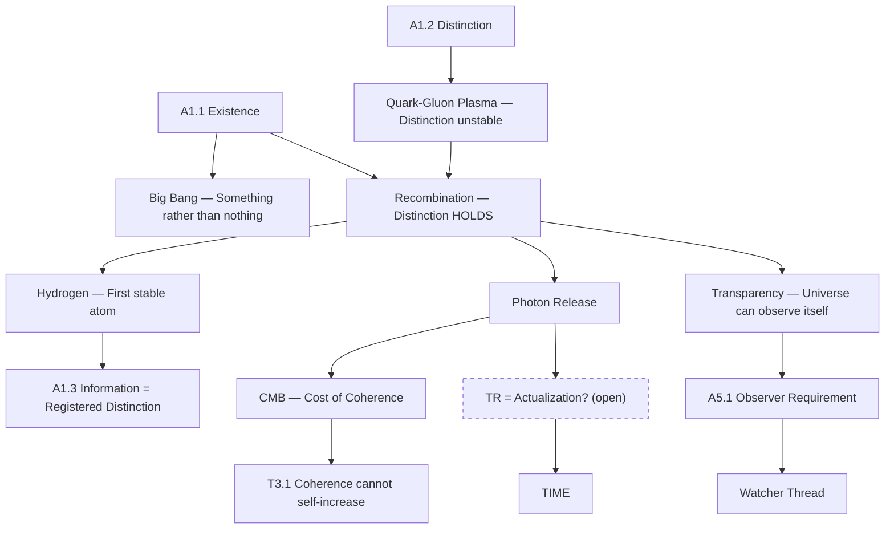

> [!header] THE FIRST ATOM — Existence and Distinction in the Big Bang
> David Lowe · POF 2828 · August 18, 2026

Were the **Big Bang's** earliest moments — **free particles** coming together to form **hydrogen** — the physical projection of **A1.1 (Existence)** and **A1.2 (Distinction)** playing out?

---

## The Physics

The **early universe** was not made of atoms. In the first **microseconds**, quarks and gluons existed in a **plasma** too hot for binding. No **stable structures**. No **persistent distinctions**. Everything that formed was immediately destroyed by the **energy density**.

**Three minutes in**: nucleosynthesis. **Protons** and **neutrons** bind into helium, deuterium, trace lithium. But **electrons** are still free — the universe is a **hot plasma** where light cannot travel because **photons** scatter off free electrons constantly. No signal can propagate. No **information** can be stored durably. The universe is **opaque**.

> [!evidence] The CMB — Receipt of First Information
> **380,000 years in**: recombination. The universe cools enough for **free electrons** to bind to **protons**. **Hydrogen** forms. For the first time, a distinction is **STABLE** — this electron belongs to this proton, not that one. And the **photons**, released from their scattering prison, travel freely for the first time. The universe becomes **transparent**. Light can carry **information**.
>
> Those photons are still visible. The **cosmic microwave background** — the oldest light in the universe — is literally the **receipt** from the universe's first act of **stable information storage**.

---

## The Mapping

> [!bridge] A1.1 → Existence Grounds the Bang
> **A1.1 (Existence)** does not "happen" at the Big Bang. A1.1 is **ontologically primitive** — it grounds the Big Bang, it is not produced by it. But the Big Bang is what A1.1 **LOOKS LIKE** from inside the **physical layer**. Something rather than nothing — and here it is, erupting.

> [!claim] A1.2 → Distinction Holds at Recombination
> **A1.2 (Distinction)** projects physically as **particle differentiation**. The **quark-gluon plasma** is undifferentiated — distinction exists but cannot stabilize. **Recombination** is the moment distinction **HOLDS**. The electron is not the proton. The binding is not the separation. This is not that — and for the first time, the universe can **remember** the difference.

> [!bridge] A1.3 → Hydrogen as First Information
> **A1.3 (Information = registered distinction)** projects as the first **stable hydrogen atom**. A **registered distinction** IS information (the axiom chain's derivation). Hydrogen is the universe's first **durable information storage** — this electron bound to this proton, a fact the universe will not forget.

> [!derivation] T3.1 → Coherence Costs Are Written in Light
> **T3.1 (Coherence cannot self-increase)** projects as the **photon release**. When the electron binds to the proton, **energy** is released as a photon. **Structure gained**, **entropy paid**. The binding is not free. The **CMB** is the cost-of-coherence written across the entire sky.

---

## The Equal and Opposite

David's original intuition: the **binding** was an **equal and opposite reaction**. That's exactly right.

Every **binding event** in physics has this signature — something gains **coherence**, something else gets released. **Law 5** (thermodynamics) says you cannot get structure without paying **entropy** somewhere else. **Law 4** (strong force) says binding has a cost — **confinement**.

> [!insight] The First Transaction
> **Hydrogen is the first transaction. Order purchased, light released.** The receipt (CMB) is still visible **13.8 billion years** later.

---

## The Time Node

> [!claim] TR = Actualization — A Candidate for the Open Time Node
> The axiom chain has an **open time node**: A1.1 + A1.2 + **TR** → TIME, with TR reserved for David to specify.
>
> **Recombination** gives a candidate for TR: **actualization**. Existence + Distinction alone give the POSSIBILITY of information. The moment particles actually **bind** — that's actualization, and the **photon's timestamp** IS the first tick of **physical time**. David's Aug 9 ruling says time is "what the **Trinity's coupling** produces." The first coupling that produces a **durable result** in the physical universe is recombination. The photon's release marks the first moment the universe has a **RECORD** — and a record is what makes **time real** rather than merely possible.

---

## The Transparency Moment

> [!bridge] Opacity → Transparency Maps to the Watcher Thread
> The universe becoming **transparent** at recombination maps to something in the axiom chain that hasn't been said explicitly before.
>
> Before recombination, the universe is **opaque** — photons scatter, no signal propagates, no information travels. After recombination, the universe is **transparent** — light carries information freely.
>
> In the axiom chain: **A5.1** says distinctions must be **registerable by an observer** to be actualized. Before transparency, the universe cannot observe itself — every photon is scattered before it can carry a message. After transparency, **observation** becomes possible. The universe's first act of seeing is the **CMB**.
>
> This connects to the **Watcher thread**: the measurement problem asks what actualizes possibilities into definite outcomes. At recombination, the universe crosses the threshold from "distinctions exist but cannot be observed" to "**distinctions are observable and therefore actualizable**." The **observer requirement** (A5.1) and the **information requirement** (A1.3) both activate at the same moment in the physical timeline.

---

## Connection to the Fine-Tuning Litany

> [!evidence] The 1% Tolerance
> The **strong force coupling constant** being off by **1%** would mean no stable hydrogen. No hydrogen means no first **registered distinction**. **A1.3** never projects into physics. The **fine-tuning numbers** protect the axiom chain's physical projection — they are the **tolerances** within which existence + distinction can produce **stable information**.
>
> "**The numbers don't leave.**"

---

## What This Does Not Claim

> [!kill] Boundaries of This Paper
> - That the Big Bang **IS** A1.1 (ontological primitives don't "happen")
> - That recombination **IS** A1.3 (the axiom is ontologically prior; recombination is its physical projection)
> - That the CMB **proves** T3.1 (the CMB is consistent with T3.1; consistency is not proof)
> - That TR = actualization is **established** (it's a candidate, formation-stage, reserved for David)

---

*De Revolutionibus Veritatis · POF 2828 · August 18, 2026*
*Routes to: Hawking Response Case Ch 1, Axiom Chain Part I (open time node), Fine-Tuning Litany*

---

%%--- SEMANTIC TAGS ---%%
%%tag::q0_expression::c31e82e0-9bcf-402f-bd41-b9247b72b004::"Were the Big Bang's earliest moments — free particles coming together to form hydrogen — the physical projection of A1.1 (Existence) and A1.2 (Distinction) playing out?"::null%%
%%tag::q0_expression::8134bb7f-e676-4cb9-a143-945ec8c5f5c6::"The early universe was not made of atoms."::null%%
%%tag::q0_expression::9f448603-1671-4540-a0bd-91b5d83817e0::"No stable structures. No persistent distinctions."::null%%
%%tag::q0_expression::e26e3471-ba69-47f6-b0b2-3f6de0bfaea7::"Everything that formed was immediately destroyed by the energy density."::null%%
%%tag::q0_expression::f74d3dfa-170e-471b-b1e3-fb6992b89f0d::"No signal can propagate. No information can be stored durably. The universe is opaque."::null%%
%%tag::q0_expression::4ae7e3d6-5489-418d-a97b-322180a3fd94::"For the first time, a distinction is STABLE — this electron belongs to this proton, not that one."::null%%
%%tag::q0_expression::e4ee017e-092f-4098-9b78-f04a7c26716a::"The cosmic microwave background — the oldest light in the universe — is literally the receipt from the universe's first act of stable information storage."::null%%
%%tag::q0_expression::de80e0fb-0f8c-4806-82ac-1fd018d1bd8b::"A1.1 (Existence) does not  happen  at the Big Bang."::null%%
%%tag::q0_expression::bebf8b7b-ba56-43e7-b9c9-58fe4051ee32::"A1.1 is ontologically primitive — it grounds the Big Bang, it is not produced by it."::null%%
%%tag::q0_expression::7a84b269-bb3e-4bf6-9af5-a8067ac04fe3::"But the Big Bang is what A1.1 LOOKS LIKE from inside the physical layer."::null%%
%%tag::q0_expression::a2e90808-f864-4e84-88cf-919e8a5a1df7::"A1.2 (Distinction) projects physically as particle differentiation."::null%%
%%tag::q0_expression::c53e8d52-600a-4016-8bce-824093cbe3ed::"The quark-gluon plasma is undifferentiated — distinction exists but cannot stabilize."::null%%
%%tag::q0_expression::cd860ff2-5bcd-4273-a9d4-096debf2c8f1::"Recombination is the moment distinction HOLDS."::null%%
%%tag::q0_expression::5efdeba6-11c8-44d4-8e7b-ba38d709ebd0::"A1.3 (Information = registered distinction) projects as the first stable hydrogen atom."::null%%
%%tag::q0_expression::0cb35f69-2ea0-49a9-bfb9-14091777ab04::"Hydrogen is the universe's first durable information storage — this electron bound to this proton, a fact the universe will not forget."::null%%
%%tag::q0_expression::f002f697-2a56-43dd-bff6-f1f95b4c1509::"T3.1 (Coherence cannot self-increase) projects as the photon release."::null%%
%%tag::q0_expression::270d0b13-569a-4e39-9a3c-0785b922579d::"Structure gained, entropy paid."::null%%
%%tag::q0_expression::13d5493f-96fd-4edf-8b2f-1aefdf76bf7b::"The CMB is the cost-of-coherence written across the entire sky."::null%%
%%tag::q0_expression::2bacfade-be85-4c51-8da9-1348abb31fa8::"Every binding event in physics has this signature — something gains coherence, something else gets released."::null%%
%%tag::q0_expression::bfdc141a-b2cd-4790-9d91-cdb8fbac2536::"Hydrogen is the first transaction. Order purchased, light released."::null%%
%%tag::q0_expression::455b8b8c-d8e7-435b-a36e-a4923e97a879::"The photon's timestamp IS the first tick of physical time."::null%%
%%tag::q0_expression::63d94a71-ed00-4f0d-b68b-f9bf69a21cf9::"A record is what makes time real rather than merely possible."::null%%
%%tag::q0_expression::9e1c4d21-d76e-49ff-ab7a-6dfdb6a913c8::"Before transparency, the universe cannot observe itself — every photon is scattered before it can carry a message."::null%%
%%tag::q0_expression::b193cdb2-6d53-48ef-9dce-ee520b45e8e7::"At recombination, the universe crosses the threshold from  distinctions exist but cannot be observed  to  distinctions are observable and therefore actualizable."::null%%
%%tag::q0_expression::e11467d2-88fe-4e6d-8c18-63f034935cf3::"The strong force coupling constant being off by 1% would mean no stable hydrogen."::null%%
%%tag::q0_expression::69a09467-29df-4221-8934-d71eb7894c53::"The fine-tuning numbers protect the axiom chain's physical projection — they are the tolerances within which existence + distinction can produce stable information."::null%%
%%tag::q0_expression::4de0d102-e2f0-42a9-aa66-bce9b0f5a0a5::"The CMB is consistent with T3.1; consistency is not proof."::null%%
%%tag::q0_expression::8d8f7b99-6f36-4bdb-9108-d1f47fbe00c3::"TR = actualization is a candidate, formation-stage, reserved for David."::null%%
%%tag::q1_referent::f53e090c-ecb4-4141-89f9-3818e517f05a::"The Big Bang's earliest moments (free particles forming hydrogen)"::null%%
%%tag::q1_referent::5d57c541-aaa9-475d-9b5c-7e3f1fac6f6c::"A1.1 (Existence) — ontologically primitive, grounds the Big Bang, not produced by it"::null%%
%%tag::q1_referent::5ba873c5-cbc1-48fd-826a-8383d4f0de54::"A1.2 (Distinction) — projects as particle differentiation"::null%%
%%tag::q1_referent::0f710778-c5b4-4ada-86ed-359f2fee57f6::"A1.3 (Information = registered distinction) — projects as first stable hydrogen atom"::null%%
%%tag::q1_referent::8f3dbbdb-1054-4a66-9eec-771ef64059f7::"T3.1 (Coherence cannot self-increase) — projects as photon release"::null%%
%%tag::q1_referent::a668581e-aaf9-40d1-b285-2a7134a349b8::"The cosmic microwave background (CMB) — oldest light, receipt of first stable information storage"::null%%
%%tag::q1_referent::6a3ab275-8243-49da-a8da-4f5eca47da23::"TR (open time node) — candidate: actualization"::null%%
%%tag::q1_referent::4155191e-a680-4d72-b2fa-228ce818bf60::"The strong force coupling constant — fine-tuning tolerance"::null%%
%%tag::q2_identity::6c5b417b-7216-4652-abb7-34298f74a4a3::"Stable distinction: this electron belongs to this proton, not that one"::null%%
%%tag::q2_identity::d71e4e30-043d-4769-8423-f2a0bba6c1a1::"Hydrogen as first durable information storage — this electron bound to this proton"::null%%
%%tag::q2_identity::88ffe110-e87b-417e-beb8-5417f7646e68::"A1.1 is ontologically primitive — grounds the Big Bang, not produced by it"::null%%
%%tag::q3_requirements::36973288-f36f-4157-87dd-384dad7a142b::"For A1.3 to project: stable hydrogen must form (requires fine-tuning of strong force coupling constant)"::null%%
%%tag::q3_requirements::fd1b1f44-48dc-479b-aea4-d2982a27c810::"For time to be real: a record must exist (photon's timestamp)"::null%%
%%tag::q3_requirements::a53ead1c-9f83-4dc5-86fc-6d82d8fea877::"For observation to be possible: universe must be transparent (photons not scattered)"::null%%
%%tag::q4_variance::33157162-c817-4d09-a271-4e11e0ed96fc::"Before recombination: distinctions exist but cannot stabilize (quark-gluon plasma)"::null%%
%%tag::q4_variance::dba4c5c5-11f1-4dea-9d7c-6691b2352624::"After recombination: distinctions are stable and observable"::null%%
%%tag::q5_operations::84bc4f96-81ae-4c4a-9dc2-9c64a793d5a7::"Binding event: something gains coherence, something else gets released (photon)"::null%%
%%tag::q5_operations::173b2229-8b26-4d03-82f1-5242629d6cee::"Photon release: marks first tick of physical time, enables information travel"::null%%
%%tag::q5_operations::f1d29de8-8434-4e17-aae4-65fe3ea9db8a::"Universe becoming transparent: enables observation, information propagation"::null%%
%%tag::q6_transitions::7a4ebd35-00b8-4d3f-893c-54b8f16e5e36::"From opaque (photons scatter, no signal) to transparent (light carries information freely) at recombination"::null%%
%%tag::q6_transitions::ff9ee158-700d-42c9-815b-bc7ce0509b88::"From quark-gluon plasma (undifferentiated) to hydrogen (stable distinction) via recombination"::null%%
%%tag::q7_constraints::dcf7cd87-92c7-471f-8b61-8bb7ad79ecb7::"Strong force coupling constant must be within 1% tolerance for stable hydrogen"::null%%
%%tag::q7_constraints::283a48bd-a32d-4f63-9e99-6f85ac0f3646::"Before recombination: no stable structures, no persistent distinctions"::null%%
%%tag::q8_consequences::31e4e79f-b699-4e9e-90fc-87031b513c23::"If hydrogen forms: A1.3 projects into physics, universe has durable information storage"::null%%
%%tag::q8_consequences::b9503b24-fb64-480a-a4f6-36cd9cb063dc::"If photon released: CMB is visible 13.8 billion years later, time becomes real"::null%%
%%tag::q8_consequences::e641eb32-90f8-4767-8be6-08c20519918e::"If strong force coupling constant off by 1%: no stable hydrogen, A1.3 never projects"::null%%
%%tag::q9_representations::b0b16b95-0bb3-4f6e-a852-bd982516608a::"Physical representation: Big Bang, nucleosynthesis, recombination, CMB"::null%%
%%tag::q9_representations::918f7a31-38af-4a08-9b7a-78ce666d0a62::"Axiom chain representation: A1.1, A1.2, A1.3, T3.1, A5.1, TR"::null%%
%%tag::q10_preserve_lose::89cae393-c416-4951-97bd-d6f88c79514b::"Physical representation preserves temporal sequence; loses ontological primacy of axioms"::null%%
%%tag::q10_preserve_lose::fa88f036-5519-40d9-8780-ff2b72fc0c9c::"Axiom chain representation preserves ontological grounding; loses physical detail"::null%%
%%tag::q11_if_true::16e3bfc4-b614-4200-8892-f6f1d368164d::"If recombination is the physical projection of A1.1/A1.2: universe has stable distinctions, information storage, and time becomes real"::null%%
%%tag::q11_if_true::973da623-c7af-4751-b1ff-6a49ad31b1ce::"If CMB is cost-of-coherence: entropy paid for structure, visible as CMB"::null%%
%%tag::q12_if_false::94f74677-fa73-4fbd-a5ae-b7aac20a3dea::"If strong force coupling constant off by 1%: no hydrogen, no first registered distinction, A1.3 never projects"::null%%
%%tag::q12_if_false::7d54655b-f31c-42fe-aa37-00a2c0e8e23b::"If TR ≠ actualization: time node remains open, candidate rejected"::null%%
%%tag::q13_discriminators::95c3cdba-4082-419e-8f16-ee0832c4d334::"CMB visibility: consistent with T3.1 but not proof (explicitly stated as non-discriminating)"::null%%
%%tag::q13_discriminators::0672b956-ca0e-4a11-aced-2cf149daa6b8::"Fine-tuning of strong force coupling constant: 1% tolerance discriminates between stable hydrogen and no hydrogen"::null%%
%%tag::q14_role::0a8b90f3-496b-4097-85d3-451ba2d9bb71::"The question introduced the investigation: mapping Big Bang moments to axioms"::null%%
%%tag::q14_role::0d03131b-470d-449b-bcfc-0f752caf2fd7::"The physics section reported evidence: timeline of early universe events"::null%%
%%tag::q14_role::eaae0b6c-22da-4971-8dea-d1407e39d43f::"The mapping section fixed meaning: connected axioms to physical projections"::null%%
%%tag::q14_role::d11072ca-48e0-4c41-8d23-a76440c56a93::"The time node section proposed a candidate: TR = actualization, left unresolved"::null%%
%%tag::q14_role::35f211d6-e88a-46d5-b999-e9442e748473::"The transparency moment section connected domains: physics to axiom chain (A5.1, A1.3)"::null%%
%%tag::q14_role::3e48dbd8-aaf8-4142-840b-2de76b0c0084::"The fine-tuning litany section restricted states: specified tolerance for projection"::null%%
%%tag::q14_role::aacb1fb0-929b-498e-8fa4-35d373862308::"The 'What This Does Not Claim' section specified non-consequences: explicitly denied upgrades (consistency ≠ proof, candidate ≠ established)"::null%%
%%--- END SEMANTIC TAGS ---%%
